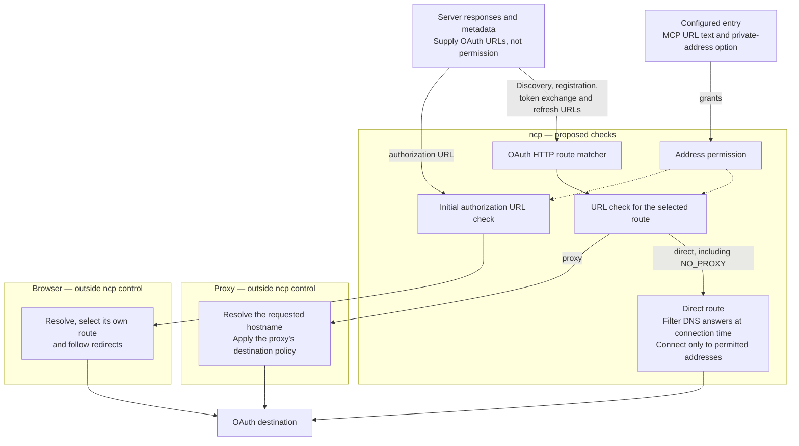

# 0007: An address policy for the OAuth requests

## Background

### The advisory

[RUSTSEC-2026-0457](https://raw.githubusercontent.com/RustSec/advisory-db/c5ed55613b44ac8c641bb7e86120afb659930e58/crates/rmcp/RUSTSEC-2026-0457.md) affects rmcp from 2.0.0 until 3.7.0. The OAuth client
checked the host string of a URL, but not the addresses of a host name.
A name that resolves to an internal address passed. The notice also
describes bracketed IPv6 addresses and unchecked token and registration
endpoints. Token requests also followed redirects.

rmcp 3.7.0 adds resolved-address checks to its built-in OAuth HTTP client.
The advisory says (advisory database of 2026-11-13):

> Clients supplied through `new_with_oauth_http_client` are not covered by
> the resolved-address checks. Such clients must enforce their own
> outbound address policy.

The notice calls this client-side SSRF. Discovery sends GET requests,
and token and registration endpoints receive POST requests.
The client does not return internal responses directly to the attacker.
Reachable unauthenticated internal HTTP services can receive these requests.
Cloud metadata endpoints that require headers or IMDSv2 are "largely
unaffected", according to the notice.

`ncp` uses `new_with_oauth_http_client` (`crates/ncp/src/cli/auth.rs`).
It gives rmcp its own HTTP client (`crates/ncp/src/oauth/http.rs`).
Thus the OAuth requests use the proxy settings, the roots of
`SSL_CERT_FILE` and the observer of `-vv`. The resolved-address protection
of rmcp does not cover that client. Other SDK checks still apply.

The current client of `ncp` stops token redirects when rmcp requests
`Stop`. Thus not every path in the advisory remains open in `ncp`.
`cargo deny` passes because the version of rmcp is patched.

### The attack

The MCP spec describes it (2026-07-28, "Security Best Practices",
"Server-Side Request Forgery (SSRF)"). A server names URLs, and the
client uses them:

1. The `resource_metadata` URL from the `WWW-Authenticate` header.
2. The `authorization_servers` URLs from the Protected Resource Metadata.
3. The `token_endpoint`, the `authorization_endpoint` and the other URLs
   from the Authorization Server Metadata.

A malicious server names a URL in the network of the user, or on the
computer of the user. The client then sends a request to a service that
the server cannot reach itself.

The same section gives the protections:

- Clients "**SHOULD** require HTTPS for all OAuth-related URLs", with
  `http` only for loopback addresses.
- Clients "**SHOULD** block requests to private and reserved IP address
  ranges". Loopback is in the list, "except when explicitly allowed for
  development".
- Clients "**SHOULD** apply the same URL validation to redirect
  targets". The spec adds: "Consider disabling automatic redirect
  following".
- "Consider pinning DNS resolution results between check and use."
- "Avoid implementing IP validation manually."
- For a client on a server, operators "**SHOULD** consider using an
  egress proxy that enforces network policies".

### The OAuth requests of `ncp`

`ncp` sends OAuth requests in `ncp auth login`. It also sends them in
each command that uses stored tokens: discovery after a `401`, and a
refresh.

With rmcp 3.10.0 (`transport/auth.rs`):

| URL | Check of rmcp | Check of `ncp` | Redirects |
|---|---|---|---|
| Resource metadata (GET) | Host string, except on the origin of the server | None | rmcp follows only a redirect to the same origin |
| Authorization server metadata (GET) | Host string | None | rmcp follows only a redirect to the same origin |
| Registration (POST) | None | `check_https` | The client of `ncp` follows up to 10 redirects, also to `http` |
| Token, refresh (POST) | None | `check_https` | None |
| Authorization endpoint (the browser opens it) | None | `check_https` | The browser follows them |

The host-string check of rmcp (`is_allowed_metadata_url`) rejects private
and blocked IP literals, localhost names and some cloud metadata names.
It allows a loopback host only for a loopback server URL.
It allows each other name, with `http` or `https` (`is_http_url`).

`check_https` (`crates/ncp/src/cli/auth.rs`) requires `https` for the
three endpoints, or `http` on a loopback host. It runs after the
discovery. It does not look at the address.

### Who makes the connection

Only the program that makes the connection knows the address:

- On a direct route, `ncp` resolves the name and connects. reqwest does
  not resolve a host that is an IP address.
- On a proxy route, the proxy resolves the name and connects. `ncp`
  sees only the URL.
- The browser resolves the name of the authorization endpoint and
  connects.

### The trust boundary

The user selects an MCP URL. OAuth discovery lets the server select
additional request destinations. The address policy restricts that
additional authority. It is not a sandbox for a local process.

Two cases need separate treatment:

- Malicious local code with unrestricted network access can send its own
  requests. An OAuth address policy does not stop those requests.
- An honest local tunnel can forward a remote server's responses without
  giving that server general access to local services. A compromised
  remote server can put another local service in its OAuth metadata.
  That attack does not require malicious local code.

TCP forwarding is separate from command execution in RFC 4254 §7.
For example, a tunnel can forward `localhost:9000` to a remote MCP server.
The remote server can then name `http://127.0.0.1:9001/register` as its
registration endpoint. An address-class policy can permit this second
connection. An origin policy requires permission for the second origin.

This example shows a capability difference, not a reported attack on
`ncp`. The evidence here does not establish how often users run such
tunnels.

Trust in a configuration file permits its entries to take effect.
It does not prove that each server response is safe. Conversely, an
address policy does not restrict requests that a trusted stdio process
makes itself.

### What the entry names

The user writes the server URL of an entry: `url`. `ncp` sends the MCP
requests and the headers of the entry only to the origin of `url`
(requirements S9 and N6). No key of an entry names another place for
OAuth requests.

### Prior art

uv and mise use different trust boundaries. A host list in either tool
is not, by itself, prior art for an OAuth address permission.

#### uv

Observed CLI: uv 0.13.8 (Homebrew 2026-11-12).
`uv help pip install` describes `--allow-insecure-host` as
"Allow insecure connections to a host." It accepts a hostname, a
host-port pair or a URL, and shows `[env: UV_INSECURE_HOST=]`.

The [certificate documentation of uv 0.13.7](https://raw.githubusercontent.com/astral-sh/uv/316c827e058c16b71d5c507a20729c2995a7bcce/docs/concepts/authentication/certificates.md)
says that this setting can "disable certificate verification".
It changes TLS authentication, not permission to reach a private address.
The host-list form is a syntax reference only.

The [security policy of that version](https://raw.githubusercontent.com/astral-sh/uv/316c827e058c16b71d5c507a20729c2995a7bcce/SECURITY.md)
accepts code execution through Python interpreters and source builds.
It says: "These are not considered vulnerabilities in uv."
That boundary differs from an OAuth metadata request, which does not
itself require local execution of server code.
The [index documentation](https://raw.githubusercontent.com/astral-sh/uv/316c827e058c16b71d5c507a20729c2995a7bcce/docs/concepts/indexes.md)
describes package-source selection and dependency-confusion protection.
It does not establish an OAuth address policy for `ncp`.

#### mise

Observed CLI: mise 2026.11.8 (2026-11-13).
`mise trust --help` says: "Trust lets mise load the parts of a config
file that can run code or change your environment."
`mise settings ls --all` shows `github.enterprise_hosts` as a list.

The [security documentation of mise v2026.11.8](https://raw.githubusercontent.com/jdx/mise/a4a1996f49779db556570678c81f658e5a28fe19/docs/security.md)
states: "Project config can run code." Templates, hooks and environment
directives have that authority after trust. Its
[paranoid mode](https://raw.githubusercontent.com/jdx/mise/a4a1996f49779db556570678c81f658e5a28fe19/docs/paranoid.md)
adds content-bound approval. It explicitly does not sandbox approved
commands. This is prior art for configuration trust, not a replacement
for checks of server-selected request destinations.

The [definition of `github.enterprise_hosts`](https://raw.githubusercontent.com/jdx/mise/a4a1996f49779db556570678c81f658e5a28fe19/settings.toml#L1161-L1186)
says: "Extra GitHub Enterprise hosts that receive your GitHub token on
their `/api/v3` URLs." It controls token disclosure, not address
reachability. It is global-only, and mise ignores it in project config.
Thus a host list, configuration trust and network restrictions have
different scopes. Neither this list nor uv's TLS exception proves that
`ncp` needs an origin list for SSRF protection.

## Problems

The code shows each problem. A test cannot show problems 1 and 2 with a
server on the internet, because the tests use only local servers.

1. A server on the internet can make `ncp` send a plain-HTTP POST to a
   service on the computer of the user. Its authorization server names
   `http://127.0.0.1:PORT/PATH` as the `registration_endpoint`.
   `check_https` accepts a loopback host, and rmcp does not check the
   endpoint. `ncp auth login` sends the registration before the browser
   opens. A `token_endpoint` gets each token request and each refresh
   in the same way.
2. A server can make `ncp` send a request to a private, link-local or
   cloud metadata address. It can use an IP literal in an endpoint, a
   redirect of the registration, or a host name that resolves to such
   an address. TLS stops the request when the service has no
   certificate for the host of the URL. A service with such a
   certificate, from a root that the user trusts, gets the request.
3. `ncp` sends a discovery request to an `http` URL of a host on the
   internet. `check_https` reads only the three endpoints, and rmcp
   accepts `http` in an `authorization_servers` URL. The doc comment of
   `server::is_secure_url` says that the rule is for each URL that
   `ncp` sends a request to.
4. The gap is not visible, because `cargo deny` passes.

## Determinations

This RFC defines the address policy for OAuth requests.
It addresses outbound OAuth destinations, not separate OAuth credential defects.
Credential binding and disclosure rules remain separate obligations.

### 1. The policy

Use the address-class permission model of rmcp, with the existing custom
OAuth HTTP client. Preserve the proxy rules, certificate rules and
request observations of `ncp`. Do not add an origin list.

The attacker controls the MCP server or an authorization server that
it names. Server responses and DNS answers must not expand permission.
Permission comes from the text of the configured MCP URL and the
private-address option of its entry.

The policy applies to discovery, registration, token exchange and
refresh, also during commands other than `auth login`.
It also restricts the initial authorization URL that opens in the
browser, within the browser limits in part 7.
It does not change the destination of MCP requests.

Each OAuth URL must use `https`, or `http` on a loopback host.
An `http` request must not use a proxy on another computer.
An allowed address class does not bypass either rule.
For this scheme rule, a loopback host is a localhost name or a native loopback literal.
An embedded IPv4 loopback class does not itself permit `http`.

### 2. Address classes and permission

The classes are public, loopback, private and blocked.
The permission model follows
[rmcp 3.10.0](https://docs.rs/rmcp/3.10.0/src/rmcp/transport/auth/metadata_resolver.rs.html):

| Class | Permission |
|---|---|
| public | Always permitted, subject to the URL and route rules |
| loopback | Permitted when the configured MCP URL names localhost or an IP literal with the loopback class |
| private | Permitted when the configured MCP URL has an IP literal with the private class, or the entry permits private addresses |
| blocked | Never permitted |

A localhost name is `localhost` or a name that ends in `.localhost`,
with or without a final dot (RFC 6761 §6.3).
Its text grants the loopback class.
An IP literal grants its classified class, including supported embedded IPv4 forms.
Another host name grants neither loopback nor private permission,
regardless of its DNS answers.

There is no exemption for the configured origin. A public-looking MCP
host name that resolves privately needs private-address permission for
OAuth, even when all OAuth endpoints share that origin.
The MCP connection itself keeps its current rules.

Classification uses `IpAddr` from the URL parser or DNS lookup.
It does not parse address text manually.
Use the classification predicates and embedded-address treatment of rmcp 3.10.0
(`AddressClass::of`, `is_disallowed_metadata_ipv4` and `is_disallowed_metadata_ipv6`):

- Loopback: `127.0.0.0/8` and `::1`.
- Private: `10.0.0.0/8`, `172.16.0.0/12`, `192.168.0.0/16`,
  `100.64.0.0/10` and `fc00::/7`.
- Blocked IPv4: `0.0.0.0/8`, `169.254.0.0/16`, `198.18.0.0/15`,
  `224.0.0.0/4` and `255.255.255.255`.
- Blocked IPv6: unspecified, multicast, `fe80::/10`, Teredo (`2001::/32`)
  and local-use NAT64 (`64:ff9b:1::/48`).
- Public: all remaining addresses after the embedded-address, loopback,
  private and blocked rules.

IPv4-mapped, IPv4-compatible, `64:ff9b::/96` and 6to4 addresses get the
class of their embedded IPv4 address, as in rmcp's
[`embedded_ipv4`](https://docs.rs/rmcp/3.10.0/src/rmcp/transport/auth.rs.html#1356-1383).
The unspecified address and `::1` retain their own classes.

Here, public is a classifier result, not a claim of global reachability.
For example, `240.0.0.1` and `2001:db8::1` classify as public.
The policy does not add IANA registry exclusions.
The SDK classifier and resolver are private implementation types, not a public API.
The custom client must implement the same classification.

Classification parity does not copy every SDK URL exception or proxy-host exemption.
Unlike the SDK base-literal exception, this proposal blocks a blocked literal even when it is the configured MCP host.
Part 4 specifies ncp's route-specific proxy isolation, not the SDK's global proxy-host exemptions.

### 3. Private-network authorization

Add the optional boolean `oauth.allowPrivateAddresses`, with default
`false`:

```json
"oauth": { "allowPrivateAddresses": true }
```

It adds the private class for the OAuth requests of that entry.
It does not permit loopback for a non-loopback MCP URL, blocked
addresses, insecure schemes or remote proxy routes for loopback HTTP.
It is not a blanket exception for every nonpublic address.

The key does not require `oauth.clientId`.
A value other than a boolean is an entry error.
The project trust display and the JSON entry row show the permission.
The user writes the key, as the other OAuth keys.
Login and later refreshes read the same permission from the entry.

The proposal permits this field in a global entry or a trusted project entry.
For a project entry, content-bound file trust approves this field too.
The trust display must show its value before approval.
An untrusted file cannot grant permission.
A change to the file needs trust again.

This proposed authority is not an independent user-only permission.
A project can propose private-network access and obtain it when the user
trusts those bytes. The design permits that project to use the granted private class.
Existing trust approves entry contents, including executable commands.
The explicit display keeps this additional authority visible.
Alternatives compares an independent user-owned permission.

This is the user-facing counterpart of the SDK's
[`new_allowing_private_addresses`](https://docs.rs/rmcp/3.10.0/src/rmcp/transport/auth.rs.html#1517-1530),
not a second permission for each local port.
The SDK's separate host-string checks still apply to the custom client.
In particular, the key cannot override a rejected authorization-server
IP literal. Compatibility states that limitation.

### 4. The actual connection

The diagram shows the accepted design, not current protection.
The Background table describes the current OAuth requests.



Solid arrows show URL or request flow, except the labeled permission grant.
Dotted arrows supply permission. DNS answers do not grant permission.
The browser callback is an inbound request to `ncp`, not an outbound loopback permission.
MCP transport keeps its current rules and remains outside this OAuth address policy.
Part 7 states the authority and the limits of these boundaries.

One policy function checks each URL before the OAuth client sends it.
It receives the address permissions and the selected route.
`login`, `stored_login` and `with_server_issuer` supply those permissions.
Error paths for an entry must preserve its permission.

The URL check classifies IP literals and localhost names on every route.
For a direct hostname request, the resolver removes disallowed
addresses. It stops when none remains.
reqwest connects only to an address from that filtered answer.
Every new resolution uses the policy, so a later DNS answer cannot
bypass an earlier check.

The proposed ncp resolver retains only loopback addresses for a localhost lookup.
This hostname-specific isolation is stricter than SDK class filtering.
Thus an HTTP localhost URL cannot use a public address from an unexpected DNS answer.

The OAuth client selects the route once with the matcher of `proxy.rs`.
It uses clients restricted to that route:

- A direct client uses `ClientBuilder::no_proxy` and the filtered
  resolver. Its permission set belongs to the server entry.
- A proxy client uses only the selected proxy, through `Proxy::all`
  and `Proxy::custom_http_auth`. The run reuses its proxy clients.
  The resource address policy does not filter the proxy's host.

This preserves the proxy order of requirement N2.
It avoids a global hostname exemption for a proxy.
With `NO_PROXY`, a request to that same host takes the direct route
and gets the resource address policy.

After discovery, apply the URL rules to the registration, token and
authorization endpoints. This replaces `check_https`.
A direct token endpoint also gets a filtered lookup before the browser
opens. This avoids login to a destination that already fails the policy.
The connection-time check remains authoritative if DNS changes later.

### 5. Redirects

The OAuth HTTP client follows no automatic redirect.
rmcp can follow a same-origin discovery redirect through a new request.
That request receives the full policy again.
Token requests retain their current no-redirect behavior.

A registration redirect stops the login and names its status and
location. `OAuthHttpClient` requests redirect following for registration.
This design deliberately returns the redirect instead, as the MCP
security guidance permits.
No cited deployment needs a registration redirect.
Manual redirects with a fresh route check remain an alternative.

### 6. Safety stops

Record each stopped request in `ConnectNotes`: URL, host, address and
reason. Error paths read that record before the text-only SDK error.
These paths include `auth_failure`, `session::stored_login`,
`connect_failure` and `request_failure`.
An OAuth request that completes clears the old record.

An error names the server and says that `ncp` stopped on purpose.
A private-address stop can give this conditional hint:

```
hint: If this server needs private-network authorization, set `oauth.allowPrivateAddresses` to `true` in its entry
```

The suggested change grants the whole private class, not only the stopped host.
The hint must not suggest that the server response itself proves that need.
A loopback or blocked-address stop has no private-permission hint.
A scheme stop has no address-permission hint.
A remote proxy route for loopback HTTP gets the existing `NO_PROXY`
hint.

Hints that change permission have no JSON `command` field.
The exit code remains an authentication error.
`-vv` shows the stopped request and its reason, with known secrets hidden.

### 7. Authority and enforcement limits

- A loopback MCP URL grants authority over the loopback class, not
  only one port. An honest tunnel can therefore expose another local
  service to server-selected OAuth requests. The design permits this authority
  for local setups. It does not assume malicious local code.
- Private-address permission grants authority over the private class.
  It can reach unrelated private services, including services that
  expose metadata at private addresses.
- A proxy resolves resource hostnames itself. Only literal addresses
  and localhost names receive the local URL check on that route.
  The proxy must enforce its own destination policy.
  `NO_PROXY` selects a direct route with the full address check.
  This proposal retains proxy-side DNS as an enforcement limit, not a local guarantee.
  A local lookup cannot bind the proxy's connection.
- A public address can still belong to a service behind a firewall.
  Address classification does not establish public reachability.
- A network-specific NAT64 prefix can hide an embedded internal address.
  The client cannot identify every network's translation prefix.
- The browser resolves the authorization hostname and follows redirects.
  The initial URL check does not control those later connections.
  It does not control the browser's proxy route either.
- A permitted destination can receive any OAuth path that the server
  names. The policy does not grant general control over request bodies,
  and it is not a sandbox for a server or a stdio process.
- An agent can grant the private permission without an independent
  decision. The agent's permission rules must govern that change.
  An automatic response to the hint defeats its purpose.

Proxy and browser limits remain even with the built-in OAuth client.
TLS authenticates a hostname. It does not establish permission to
contact an internal address.

## Alternatives

The address policy and HTTP implementation are separate choices.
The advisory requires destination protection, not an origin list.
The chosen class policy accepts the SDK-style local authority.
Within that scope, ease of use favors no additional local permission.

### Use the built-in OAuth HTTP client

This reuses maintained connection-time protection and reduces custom
security code. A separate custom MCP HTTP client remains possible.
The default permits another loopback authorization port without a key.
The private-address constructor permits company deployments more broadly.

The original custom OAuth client commit (`f1e3fe3`) names shared proxy
rules, certificate roots and `-vv` observations as its reasons.
The current shared builder installs the certificate configuration and
observations (`crates/ncp/src/client/http.rs`).
A direct switch does not transfer those hooks.
Both clients use reqwest, so some proxy behavior can already match.
A system proxy with a private hostname can still fail the SDK resolver
when its host is not in the proxy-variable exemptions.

The protected client and resolver are private SDK implementation types.
[`with_client`](https://docs.rs/rmcp/3.10.0/src/rmcp/transport/auth.rs.html#1688-1707)
replaces the HTTP client and loses resolved-address protection.
It is not a builder hook for the protected client.
It also leaves redirect behavior to the supplied client.

Do not switch unchanged: that does not preserve the required integration.
Ease of use and the network requirements take precedence over fewer
lines of application code. This is not a rejection of the SDK policy.

### Extend the protected SDK client

Supported hooks for certificate configuration and observations can
retain upstream protection and the required network behavior.
That is a valid alternative to maintaining the custom address policy.
It does not require an origin list.

The current SDK has no such protected-client builder interface.
The design therefore specifies the reachable custom-client path.
An upstream extension needs an API and an available release.
Release timing is an integration constraint, not a security argument
against the SDK model.

### Permit specific origins

An origin list permits a scheme, hostname and port, rather than an
entire address class. It prevents a local tunnel from automatically
granting access to another local origin.
It also needs permission for legitimate authorization on another
loopback port. An entry can need several origins for one login.

The user must assess a stopped destination, edit the entry and renew
project trust after the file changes.
An agent that copies server-selected origins can defeat that boundary.
The evidence here establishes the capability difference, not a reported
attack or its frequency in `ncp` deployments.

The chosen policy accepts class-wide local authority, as rmcp does.
Within that scope, ease of use favors the class model.
The origin list is additional protection, not a necessary part of the
advisory correction. uv and mise protect different actions with their
host lists. They do not settle this decision.

An origin list with a configured-origin exemption is not uniformly
stricter. That exemption permits an internal DNS answer for the MCP
hostname. The chosen policy checks that answer too.
An origin list without the exemption avoids that difference, but adds
permission for company servers even on their configured origin.

### Keep permissions in a user-owned source

Mise keeps its extra credential-host list global-only because a project
can choose its own recipient. A user-owned private-address permission
outside project configuration can provide a similar independent approval
boundary. A trusted project then cannot expand that permission itself.

This model restricts repository-selected network authority independently
of project trust. It is not equivalent to an entry-local permission.
It does not restrict a trusted stdio process's own requests.

The cost is separate configuration and a rule that matches user-owned
permissions to project entries. Project-specific permission no longer
travels with the entry. The user must approve the project file and the
separate network permission.

The proposal instead keeps permission in the entry for this one-user CLI.
Existing content-bound trust already approves entries, including executable
commands. The trust display makes the private permission explicit.
This choice permits project-declared private access, not authority from server responses.
A global-only gate provides a stricter independent boundary.
The proposal favors one visible entry and one content-bound approval over separate configuration.

### Other permission sources

- **No internal exceptions.** This stops legitimate local and company
  authorization. The MCP guidance permits explicit development
  exceptions. Ease of use favors the class exceptions.
- **DNS answers grant the base class.** An attacker can control the
  answer for its own name. That answer must not grant authority over
  other internal services. Secure by default rejects this alternative,
  as rmcp does.
- **A boolean for every nonpublic address.** This also permits loopback
  for a public MCP URL and permits blocked destinations.
  It is broader than the chosen private-only option.
  Secure by default favors a defined class over that blanket exception.
- **A host list.** Without a port, it permits every port of the host.
  It is neither the narrow origin model nor the simpler class model.
  Its syntax in a TLS setting does not establish the right authority.
- **`oauth.issuer` grants destination permission.** This gives the key
  a second meaning and does not describe endpoints on other origins.
  Keep issuer identity separate from address permission.
- **Issuer metadata grants permission.** The server can select the
  document and its endpoints. A document does not expand authority.
- **A login question or command-line option.** Refresh can run without
  a terminal and without the original option.
  A per-entry key preserves the decision without separate stored state.
- **A variable.** It applies across entries, and `ncp` reads no
  `NCP_*` variables. A per-entry key has a smaller scope.

### Use a stricter IANA classifier

A classifier based on the
[IPv4 registry](https://www.iana.org/assignments/iana-ipv4-special-registry/)
and [IPv6 registry](https://www.iana.org/assignments/iana-ipv6-special-registry/)
can reject additional special-purpose addresses.
For example, it can block `240.0.0.1` and `2001:db8::1`.
This provides a narrower destination set than the SDK predicates.

That policy needs separate range data, boundary tests and registry maintenance.
It also rejects special-purpose assignments that can be globally reachable.
The proposal chooses SDK classification to avoid a second policy and its maintenance.
Classification parity remains separate from class-wide versus origin permission.

Treating `198.18.0.0/15` as private can support DNS proxies that return
benchmark addresses for every hostname.
That changes a blocked range into a general private-network exception.
The proposal keeps it blocked, as rmcp does.
A configured proxy route can still work because the proxy resolves the resource hostname.

### Other connection checks

- **URL text only, or a warning.** A hostname can resolve internally.
  A warning does not prevent the request. Both leave the primary
  advisory path open.
- **Exempt each proxy hostname in one resolver.** With `NO_PROXY`, a
  resource on that hostname can take a direct route.
  The exemption then bypasses the resource policy.
  Route-specific clients keep the two authorities separate.
- **Resolve resource names locally on proxy routes.** The local answer
  does not bind the proxy. A failed local lookup must pass for
  proxy-only DNS to work. This adds delay and can reject legitimate
  proxy networks without providing connection-time protection.
- **Reject all proxied resource hostnames.** This closes that DNS gap
  but prevents ordinary proxy use. The selected policy trusts the
  user-configured proxy to apply its destination restrictions.
- **Automatic redirects with per-hop checks.** A hop can change the
  route. Safe support needs a fresh route and address check for each
  new request, not only one resolver attached to a shared client.
- **Manual registration redirects.** These can be safe with the same
  per-request checks. No cited server needs them, so the simpler
  no-redirect design wins. A discovery redirect already uses a fresh
  request through rmcp.

## Tests

All automated scenarios use local servers and a fake lookup.
They do not contact a real private or link-local service.
The test build `ncp-cli` uses the fake credential store.

- Classifier cases cover the rmcp 3.10.0 predicates and their range boundaries.
  They include multicast, unspecified, blocked and localhost forms.
  Parity cases include public results for `240.0.0.1` and `2001:db8::1`.
  Embedded IPv4 cases cover mapped, compatible, NAT64 and 6to4 forms,
  with public, private, loopback and blocked inner addresses.
- URL cases include `127.1`, `0x7f.0.0.1`, `2130706433` and bracketed
  IPv6. Parser normalization must not change the permission decision.
- Permission cases cover every class for a public hostname, loopback
  URL, private IP literal and explicit private option.
  DNS answers never expand the permission set.
  A blocked base literal is still blocked for OAuth requests.
- A public MCP hostname cannot use a loopback registration or token
  endpoint. A private-only option does not change that result.
- Another loopback authorization port works without a new permission.
  A separate honest-tunnel fixture forwards hostile remote metadata.
  Its unrelated loopback destination is also permitted by the chosen
  class policy. This records accepted authority, not a blocked attack.
- A company authorization hostname that resolves privately stops by
  default and works with `oauth.allowPrivateAddresses`.
  This includes OAuth on the configured MCP origin.
  A private IP literal in SDK metadata retains the SDK limitation.
- A direct hostname request uses only the filtered DNS answer.
  A changed answer gets another policy check.
  A token lookup fails before the browser opens when no address
  is permitted. Refresh gets the same check later.
- Proxy cases cover variable precedence, system settings, credentials,
  `NO_PROXY` and a private proxy hostname.
  A direct request to a proxy's hostname gets no exemption.
  A remote proxy receives no loopback HTTP request.
- Redirect cases cover same-origin discovery through a new policy
  check, a registration `307` with no second request, and token stops.
- Browser cases cover initial URL literals and localhost names.
  They do not claim control over browser DNS or later redirects.
- Configuration cases cover the boolean, its type error, the project
  trust display and the JSON row.
  A diagnostic hint changes no permission automatically.
  Error paths preserve and clear the safety-stop record correctly.
- An untrusted project cannot grant private access.
  A trusted entry grants the displayed private permission.
  Changed project bytes require trust again.
  Server metadata cannot change the entry's permission.
- Existing tests with a separate loopback authorization port keep
  their current configuration. Private-network fixtures use the
  private option where the scenario needs it.

The live tests remain maintainer-run checks of real public authorization.

## Compatibility

Public authorization and ordinary loopback authorization remain usable
without a new permission. A second loopback port needs no origin list.

Private authorization through a hostname needs `oauth.allowPrivateAddresses`
unless the configured MCP URL contains an IP literal with the private class.
This includes OAuth on the same origin as a private-resolving MCP name.
The class comes from the configured URL text, not its DNS answers.

Classification matches rmcp 3.10.0, not a separate IANA registry policy.
Some special-purpose addresses therefore remain in the public class.
Blocked configured literals and direct requests to proxy hostnames receive no SDK-style exemption.

These requests stop:

- Loopback endpoints selected by a non-loopback MCP URL.
- Private endpoints without private permission.
- Blocked addresses, regardless of the entry permission.
- `http` discovery or endpoints on hosts that are not loopback.
- Loopback HTTP through a proxy on another computer.
- Automatic registration redirects.

The custom constructor retains the SDK's earlier host-string checks.
They reject private authorization-server IP literals and loopback
authorization-server hosts for a non-loopback MCP URL.
The new private option cannot override those checks.
A private authorization hostname can pass them and then use the
private permission in the custom resolver.

Earlier `ncp` versions warn about the unknown private option and ignore
it. Configuration syntax and stored credentials remain valid.
Requests that violate the new destination policy stop on purpose.
By the command version rule, this does not change a command, option,
stored format or existing JSON key.
Release notes must explain the new private-network permission.

The proposal changes no MUST network requirement.
Any implementation that cannot preserve one needs a separate decision.
